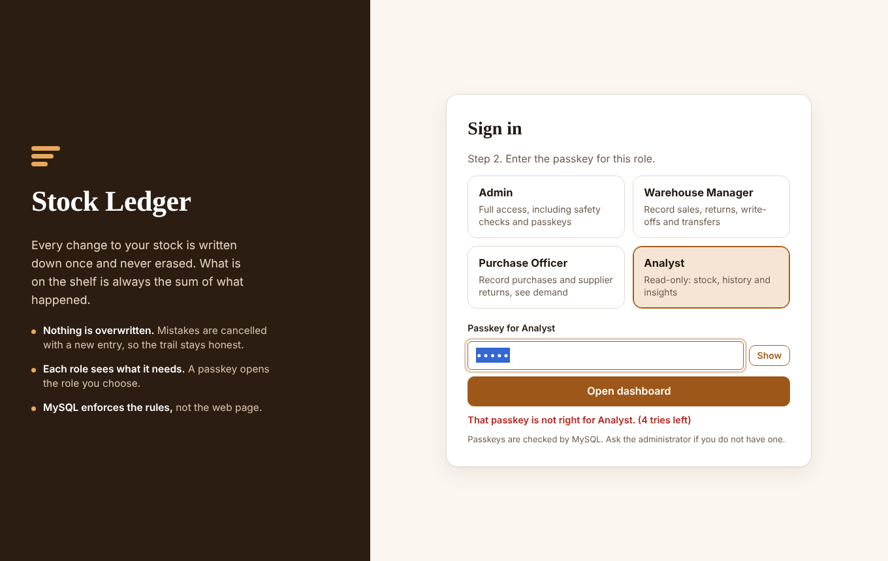
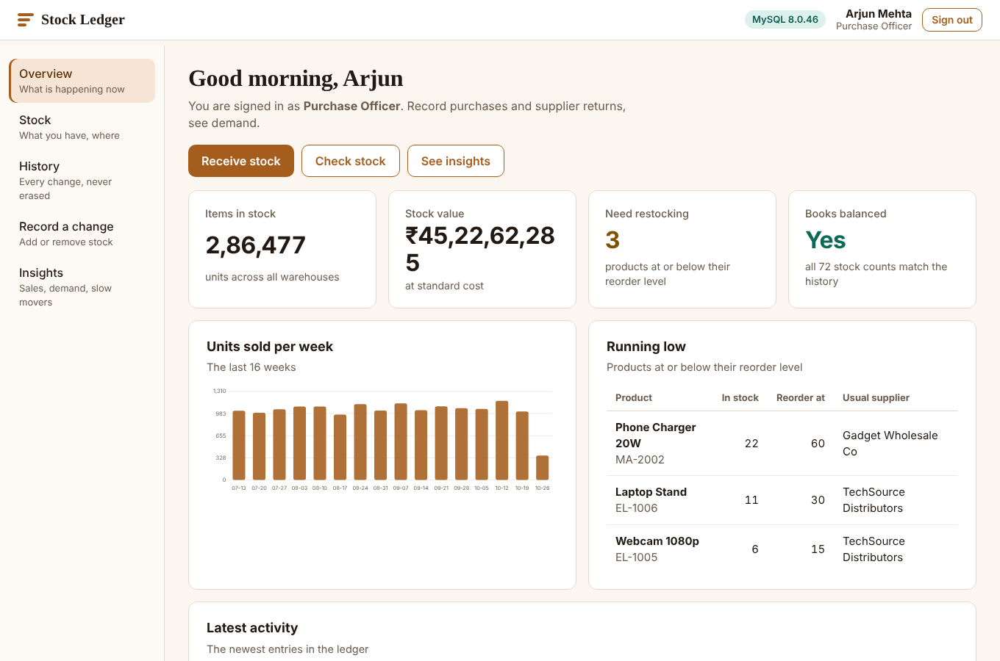
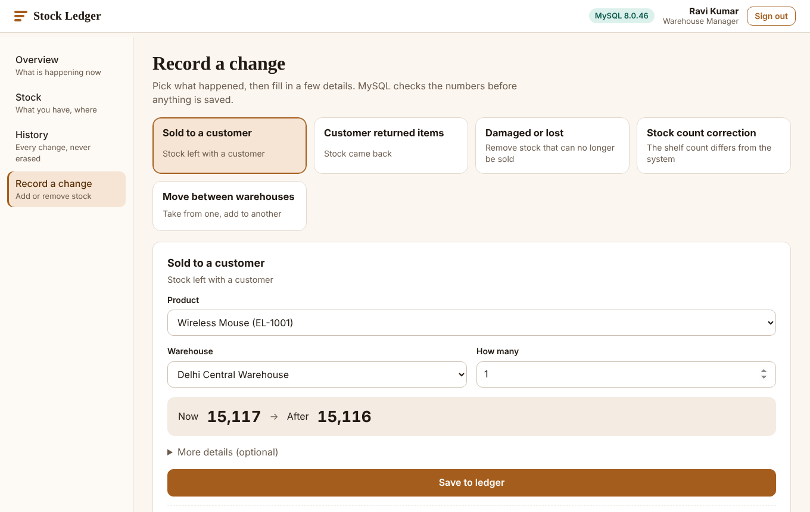
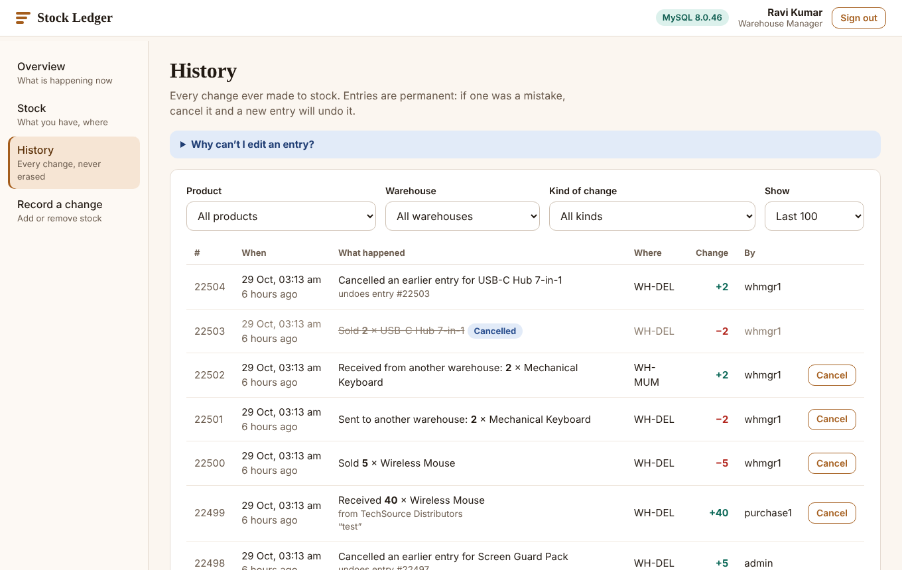
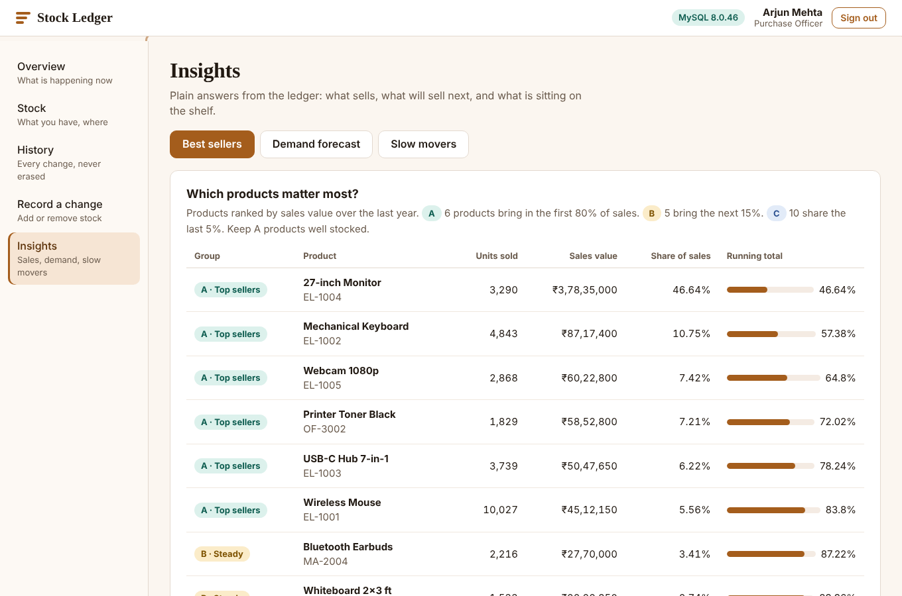
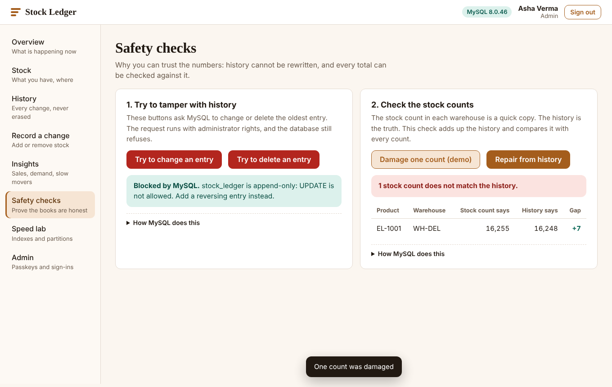
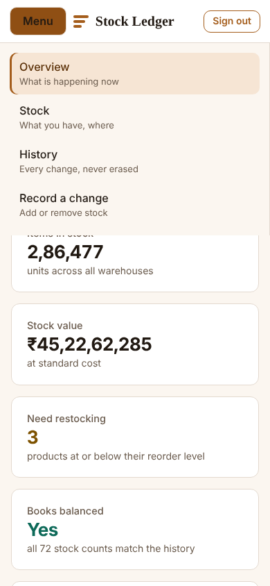

# Immutable Stock Ledger System with Analytics and Forecasting

BCSE302P Database Systems Lab project, Savir Ghai (24BCT0309), VIT.
A MySQL inventory system in which **stock is never edited, only added to**: every change is a new row in an
append-only ledger, and the quantity on the shelf is always the sum of what happened.

```
Browser  <-->  app.py (Flask, port 5000)  <-->  MySQL
 pick a role     checks the session and role      stock_ledger_db       ledger, triggers, partitions, procedures
 enter passkey   calls stored procedures only     stock_ledger_auth     passkey hashes (web account cannot read it)
```



## Features

* **Append-only ledger.** Triggers block `UPDATE` and `DELETE`. Mistakes are cancelled with a new REVERSAL entry.
* **Derived balances.** Summary tables are kept in sync by triggers and can be rebuilt from the ledger at any time.
* **Atomic transfers** between warehouses (two linked rows, all or nothing) and row locking so two sales cannot take the last unit.
* **Analytics.** ABC classification, best sellers, dead stock, demand forecast and "stock on a past date", all with window functions.
* **Speed lab.** The same query on three table designs (no index, index, index + partitions) with `EXPLAIN` output.
* **Role sign-in.** Choose a role, enter its passkey. Each role only sees the pages and actions it needs.
* **Two-layer access control.** Flask checks the role, and MySQL (`fn_role_can`, privileges) checks it again.
* **Simple screens.** Plain-language page names, a stock before/after bar when recording, a confirmation dialog before cancelling, phone-friendly layout, works offline.

## Roles and demo passkeys

| Role | Passkey | Can do |
| --- | --- | --- |
| Admin | `ADMIN-4821` | Everything, plus change passkeys and see recent sign-ins |
| Warehouse Manager | `STORE-7305` | Sales, returns in, write-offs, adjustments, transfers, cancel entries |
| Purchase Officer | `BUYER-5192` | Purchases and returns out |
| Analyst | `VIEWER-2468` | Read only: overview, history, insights |

These are demo values. The Admin can change any of them under **Admin**. Passkeys are stored only as
`SHA2(salt + passkey)` in the separate `stock_ledger_auth` schema; the web account can only call
`sp_login`, it can never read the hashes. Five wrong attempts from one address in five minutes are blocked.

## Setup (Windows)

1. Install **MySQL 8 or newer** and **Python 3.10+** (tick "Add Python to PATH").
2. Put this folder somewhere without spaces, for example `D:\stock-ledger-app`.
3. Build the database. At the `mysql>` prompt (as root):
   ```sql
   source D:/stock-ledger-app/setup_all.sql
   ```
   Forward slashes. It takes one to three minutes (about 20,000 demo movements are generated).
   Running it again wipes and rebuilds everything.
4. Install the packages: `pip install -r requirements.txt`
5. Check the database: `python check_setup.py` (expects 22/22 checks to pass)
6. Start the app: `python app.py` (or double-click `start.bat`) and open **http://127.0.0.1:5000**

The app connects to MySQL as `ledger_app` (demo password in `sql/06_security.sql`). If you change it,
run `set DB_PASSWORD=yourpassword` before starting.

## Tests

```
python check_setup.py          # 22 database checks: schema, triggers, procedures, concurrency
python tests/test_dashboard.py # 20 web tests: sign-in, passkeys, every role against every action, throttle
```

Both run against the real MySQL database, so run `setup_all.sql` first.

## Five-minute demo

| Step | Do this | Concept |
| --- | --- | --- |
| 0 | Choose **Warehouse Manager**, enter `STORE-7305` | Role-based access |
| 1 | **Overview**: stock is derived, the ledger has about 20,000 rows | Ledger idea, BCNF |
| 2 | **Record a change**: sell 5, then try 99999 (the bar turns red, MySQL refuses) | Constraints, procedures |
| 3 | Transfer between warehouses, then open **History** to see the two linked rows | Transactions, ACID |
| 4 | **History**: cancel an entry; the original is struck through, a REVERSAL row appears | Append-only correction |
| 5 | **Safety checks**: Try UPDATE / Try DELETE are blocked; corrupt a balance, then rebuild | Triggers, reconciliation |
| 6 | **Insights**: best sellers, forecast, dead stock, stock on a past date | Window functions |
| 7 | **Speed lab**: Run test, compare rows examined | Indexing, partitioning, EXPLAIN |
| 8 | Sign out, sign in as **Analyst** (`VIEWER-2468`): no Record page; a forced call is refused | Two-layer RBAC |
| 9 | Two `mysql>` windows (below) | Locking |
| 10 | `docs/RECOVERY.md` | Log-based recovery |

### Locking demo

Window A:
```sql
USE stock_ledger_db;
START TRANSACTION;
SELECT quantity_on_hand FROM stock_balance WHERE product_id = 1 AND warehouse_id = 1 FOR UPDATE;
```
Window B (hangs until A commits):
```sql
USE stock_ledger_db;
CALL sp_record_movement(2, 1, 1, 'SALE', 1, NULL, NULL, 'LOCK-TEST', NULL);
```
Type `COMMIT;` in window A and B completes.

### Database logins for the viva
```
mysql -u demo_analyst   -p     (Analyst#2026)   read only; CALL sp_record_movement is denied
mysql -u demo_warehouse -p     (Warehouse#2026) can record movements, cannot read app_user
```

## Screenshots

| | |
| --- | --- |
|  |  |
|  |  |
|  |  |

## Folder map

| Path | What it is |
| --- | --- |
| `setup_all.sql` | Whole database in one file (the eight files in `sql/`, joined) |
| `sql/00` to `sql/07` | Readable parts: database, tables, triggers, write procedures, analytics, demo data, MySQL accounts, passkeys |
| `app.py` | Flask backend: sessions, role checks, API |
| `static/` | Front end (`index.html`, `style.css`, `app.js`), plain JS with hand-drawn SVG charts |
| `check_setup.py`, `tests/` | Automatic checks |
| `docs/RECOVERY.md` | Point-in-time recovery demo with binary logs |
| `docs/screenshots/` | Images of every page |
| `docs/presentation/` | Source of the 15-slide deck |
| `start.bat`, `requirements.txt` | Windows launcher and Python packages |

The project report and presenter script are separate documents (Assessment 9 format); the deck source is in `docs/presentation/`.

## Design notes

* 12 tables, keys, `CHECK` constraints, BCNF design and quarterly partitions as in the design document.
* The ledger has **no foreign keys** (InnoDB cannot put them on partitioned tables); the `BEFORE INSERT` trigger validates every reference instead.
* `ledger_app` has no direct write privilege on any table; every write is a stored procedure.
* The acting user comes from the signed session cookie, never from the request body.
* `TRUNCATE` and `DROP` do not fire triggers, which is why `ledger_app` lacks them and why `docs/RECOVERY.md` exists.

## Troubleshooting

| Symptom | Fix |
| --- | --- |
| "MySQL refused the login" | `set DB_PASSWORD=...` or re-run `sql/06_security.sql` |
| "Cannot reach MySQL" | Start the MySQL service (Windows Services) |
| Wrong passkey keeps failing | After five tries wait five minutes; or re-run `sql/07_passkeys.sql` to restore the demo passkeys |
| Page is blank | Ctrl+F5, and check the terminal running `app.py` for errors |
| `pip` not recognised | Reinstall Python with "Add Python to PATH" ticked |
